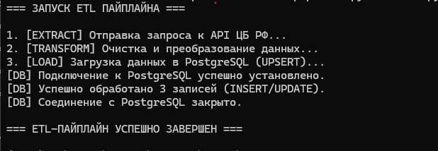
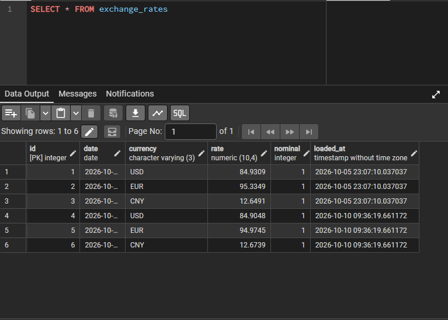

# CBR Currency to PostgreSQL ETL Pipeline

Proof-of-concept проекта по автоматическому извлечению данных о курсах валют из открытого API Центробанка РФ, их трансформации и загрузке в реляционную базу данных PostgreSQL с использованием Python (Pandas). Проект включает полный цикл: извлечение (Extract) сырого JSON, очистку и трансформацию (Transform), а также загрузку с идемпотентным UPSERT (Load).

## Стек технологий

*   **Языки:** Python 3.x, SQL (PostgreSQL)
*   **Библиотеки:** requests, pandas, psycopg2-binary, python-dotenv
*   **Инструменты:** pgAdmin, Git, Windows Task Scheduler

## Архитектура проекта

*   **В корне проекта** — Python-скрипты пайплайна:
    *   `main.py` — единая точка входа, оркестратор пайплайна.
    *   `extract.py` — извлечение данных из источника (API ЦБ РФ).
    *   `transform.py` — очистка, нормализация и преобразование JSON в плоскую таблицу.
    *   `load.py` — загрузка в PostgreSQL через паттерн UPSERT (ON CONFLICT).
    *   `config.py` — безопасный менеджмент конфигураций и учетных данных.
*   `sql/` — DDL-схемы целевой БД.
*   `.env.example` — шаблон настроек для подключения к БД.

## Особенности этапа трансформации (Data Cleaning)

*   Парсинг сырого иерархического JSON-ответа и извлечение вложенных структур.
*   Динамическая фильтрация только целевых валют для бизнеса (USD, EUR, CNY).
*   Нормализация форматов дат (отсечение timezone и времени) для загрузки в SQL тип DATE.
*   Преобразование списка словарей в двумерную структуру `pandas.DataFrame`.

## Особенности этапа загрузки (Idempotent Load)

Реализована идемпотентная загрузка данных, предотвращающая дублирование при многократном запуске скрипта в течение одного дня:
*   На уровне DDL СУБД установлено ограничение `UNIQUE(date, currency)`.
*   На уровне Python реализован паттерн **UPSERT** (`INSERT ... ON CONFLICT DO UPDATE`). 
*   Автоматическое обновление поля `loaded_at` (Timestamp) при обновлении существующих котировок.

## Как запустить проект локально

1. Клонируйте репозиторий: `git clone https://github.com/muctaev/cbr-currency-etl.git`
2. Создайте виртуальное окружение: `python -m venv venv` и активируйте его: `venv\Scripts\activate`
3. Установите зависимости: `pip install requests pandas psycopg2-binary python-dotenv`
4. Скопируйте `env.example` в `.env` и заполните своими паролями.
5. Выполните SQL-скрипт `sql/init_db.sql` в вашей базе данных PostgreSQL (через pgAdmin).
6. Запустите пайплайн: `python main.py`.

---
**Автор:** Ramil Mustaev | Проект создан в учебных целях для личного портфолио.

## Скриншоты работы проекта

Отчёт логов скрипта (main.py):

Очищенные данные в PostgreSQL (pgAdmin):

